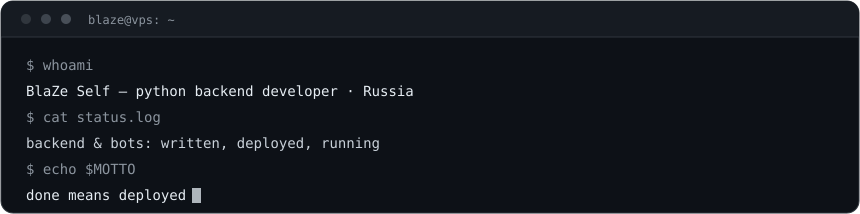
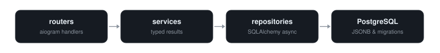
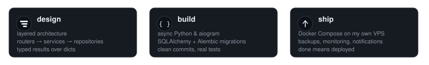
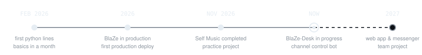

  

  &nbsp;
  

  

<h2 align="center"><code>{&nbsp;&nbsp;about&nbsp;&nbsp;}</code></h2>

  <b>👋 Hello! I'm BlaZe Self</b> — <i>Python backend developer from Russia. I build backend services — Telegram bots among them — and ship them to production.</i>

> *Backend developer from Russia focused on asynchronous Python. I design layered architectures, work with databases and ship projects all the way to production — with real users, backups and monitoring.*
>
> *Two people pushed me to try programming in early 2026 — and that was enough. I learned the Python basics in a month, then kept adding something new every day until I took on my first big project. It grew into **BlaZe**, a Telegram RPG bot set in the Tokyo Ghoul universe: ~280 modules (routers → services → repositories + DI), PostgreSQL + SQLAlchemy + Alembic, Docker Compose on my own VPS, backups, group moderation, economy, quizzes and ffmpeg video cutting. It runs in production with real users.*

<b>· quick facts ·</b>

| | |
|:--:|:--:|
| 🌱 **Learning** | FastAPI, Redis, algorithms & data structures |
| 🤝 **Open to** | collaboration on backend projects |
| 🗓 **Coding since** | February 2026 — every single day |
| 🎓 **Status** | 9th grade student, coding after school |
| 🧠 **Focus** | clean architecture, async Python, production stability |

<h2 align="center"><code>{&nbsp;&nbsp;stack&nbsp;&nbsp;}</code></h2>

| core | data | infra |
|:--:|:--:|:--:|
|   |    |    |

<b>next →</b>&nbsp;
  

<h2 align="center"><code>{&nbsp;&nbsp;projects&nbsp;&nbsp;}</code></h2>

### 🩸 [BlaZe — Telegram RPG bot](https://github.com/blazevx-self/BlaZe-bot)

  &nbsp;
  &nbsp;
  &nbsp;
  

Multiplayer RPG bot set in the Tokyo Ghoul universe. Running in production on a VPS.

  

<b>🔍 What's inside</b>

 

| Area | Details |
|:---|:---|
| 🏗 **Architecture** | ~280 modules · routers → services → repositories · Dependency Injection |
| 🗄 **Data** | PostgreSQL · SQLAlchemy 2 async · Alembic migrations · JSONB timed effects |
| 🎮 **Gameplay** | economy, character upgrades, daily bonus, quiz, Wordle, lottery with video rendering |
| 💬 **Groups** | moderation (ban / mute / kick / warns), anti-spam, link filter, AI chat replies |
| 🎬 **Media** | `/anime` clip & GIF cutting with ffmpeg, media library with `file_id` caching |
| 🚀 **DevOps** | Docker Compose · VPS deployment · automatic DB backups · error notifications |

 

### 🎧 [Self Music — Telegram music assistant](https://github.com/blazevx-self/Self-Music-bot)

  &nbsp;
  &nbsp;
  &nbsp;
  

Personal music assistant: finds tracks by name or artist, recognizes melodies from voice, audio and video, and serves charts and mood-based playlists right in the chat. Completed and live — [@selfmusical_bot](https://t.me/selfmusical_bot).

<b>🔍 What's inside</b>

 

| Area | Details |
|:---|:---|
| 🏗 **Architecture** | ~90 modules · routers → services → external APIs · middlewares for DB, logging, anti-spam and user sync |
| 🔎 **Search** | Deezer API for metadata & covers · paginated results · track delivery via `yt-dlp` |
| 🎙 **Recognition** | AudD API — voice messages, audio files and video, plus humming mode for sung melodies |
| 🎬 **Media** | FFmpeg audio extraction from video · track cache to avoid re-downloading |
| 📊 **Content** | Deezer new releases, genre charts, Russian top, mood playlists (road / chill / workout) |
| 👤 **Accounts** | experimental public VK profiles section · per-user feature toggles in settings |
| 🛡 **Guards** | channel subscription check · flood protection · double-click protection on inline buttons |
| 🚀 **DevOps** | Docker Compose (bot + PostgreSQL 16 + PgAdmin) · Alembic migration container · pytest suite |

 

> [!NOTE]
> More projects are coming in 2027 — a web application and a messenger, built together with a frontend developer.

<h2 align="center"><code>{&nbsp;&nbsp;why&nbsp;code&nbsp;&nbsp;}</code></h2>

  <b>It never lies to you</b> — <i>it runs exactly the way it's written, and the result depends only on you.</i> 
  every bug is honest feedback, and every fix is entirely yours.

  

> [!TIP]
> - 🧱 **Layers over spaghetti** — routers don't touch the database, services don't know about Telegram
> - 📦 **Typed results over dicts** — every service returns a dataclass with a status
> - 🔁 **Migrations over manual SQL** — every schema change is versioned
> - 🚀 **Done means deployed** — a feature isn't finished until it works in production

<h2 align="center"><code>{&nbsp;&nbsp;stats&nbsp;&nbsp;}</code></h2>

  &nbsp;
  

  

  

<h2 align="center"><code>{&nbsp;&nbsp;goal&nbsp;&nbsp;}</code></h2>

> ***Become a Middle Backend Developer, go deeper into system design
> and build reliable production-level applications.***

  

<b>🗺 Roadmap</b>

 

- [x] Python basics → async → aiogram
- [x] PostgreSQL, SQLAlchemy, Alembic
- [x] Docker, Linux, VPS deployment
- [x] Production bot with real users
- [x] Second project: Self Music bot with external APIs (Deezer, AudD, yt-dlp)
- [ ] Tests (pytest)
- [ ] FastAPI & REST APIs
- [ ] Redis
- [ ] Team project: web app & messenger
- [ ] Algorithms & data structures

<h2 align="center"><code>{&nbsp;&nbsp;links&nbsp;&nbsp;}</code></h2>

  &nbsp;
  

  <code>C O D E&nbsp;&nbsp;/&nbsp;&nbsp;B O T&nbsp;&nbsp;/&nbsp;&nbsp;F U T U R E</code>

  

